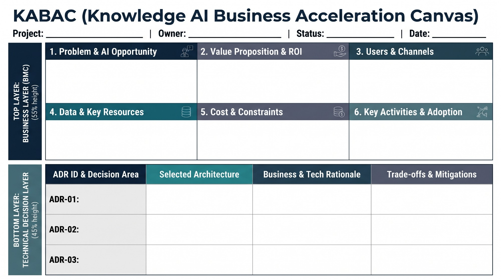

# KM-AI Vibe Code Hub

ศูนย์รวมผลงาน **AI Vibe Coding** ของทั้งองค์กร ทุกโปรเจกต์ส่งเข้ามาด้วย Template กลาง **KABAC**, ผ่านการ Audit ด้าน Regulation และ Security แล้วจึงเผยแพร่บนเว็บ Hub ให้ BU และบริษัทในเครือดาวน์โหลดโค้ด, Skills และ Prompts ไปใช้ต่อได้ทันที



## Flow ภาพรวม

```
[1. Submit]  →  [2. Intake Check]  →  [3. Audit]  →  [4. Publish]  →  [5. Reuse & Feedback]
 เจ้าของงาน       ระบบตรวจอัตโนมัติ      คนตรวจตาม Tier    ขึ้นเว็บ Hub        BU อื่นดาวน์โหลด / Fork
 กรอก KABAC       (GitHub Actions)       (Security/Legal)   พร้อม Badge        แจ้งปัญหา / ขอ Feature
 + push GitHub
```

## ส่งผลงานอย่างไร (สำหรับผู้ส่ง)

1. คัดลอกโฟลเดอร์ [`template/`](template/) ไปเป็น repo ใหม่ของโปรเจกต์
2. กรอก [`kabac.yaml`](template/kabac.yaml) ให้ครบ ดูวิธีเขียนได้ที่ [KABAC Manual](docs/KABAC-MANUAL.md) และตัวอย่างที่ [`examples/`](examples/)
3. Push โค้ดขึ้น GitHub แล้วรอให้ workflow `vibe-audit` ผ่าน (ตรวจ Secret, SAST, Dependency, PII, Skills)
4. เปิด Issue **"🚀 ส่งผลงาน Vibe Coding"** ใน repo นี้ แล้วแนบลิงก์ repo
5. ทีม AI CoE จัด Tier และส่งต่อผู้ตรวจ เมื่อผ่านแล้วจะเพิ่มลง [`registry/projects.yaml`](registry/projects.yaml) และขึ้นเว็บ Hub

ตรวจ `kabac.yaml` ในเครื่องก่อนส่งได้:

```bash
pip install pyyaml jsonschema
```

```bash
python scripts/validate_kabac.py path/to/kabac.yaml
```

## โครงสร้าง Repo

| Path | คืออะไร |
|---|---|
| [`hub/`](hub/) | **เว็บ Hub ต้นแบบ** เปิด `hub/index.html` ดูได้เลย |
| [`docs/PROGRAM-PLAN.md`](docs/PROGRAM-PLAN.md) | แผนโครงการทั้งหมด: Flow, Audit, Hub, บทบาท, Rollout |
| [`docs/KABAC-MANUAL.md`](docs/KABAC-MANUAL.md) | คู่มือ KABAC (ฉบับ Markdown + ส่วนที่ 7 Reuse & Compliance) |
| [`docs/AUDIT-CHECKLIST.md`](docs/AUDIT-CHECKLIST.md) | Checklist ตรวจ Regulation / Security / Safety แยกตาม Tier |
| [`docs/KABAC-Manual-Template.pdf`](docs/KABAC-Manual-Template.pdf) | คู่มือ KABAC ฉบับ PDF ต้นฉบับ |
| [`schema/kabac.schema.json`](schema/kabac.schema.json) | JSON Schema ของ `kabac.yaml` |
| [`template/`](template/) | Template repo สำหรับผู้ส่งผลงาน |
| [`examples/`](examples/) | ตัวอย่าง KABAC ที่กรอกเสร็จแล้ว |
| [`registry/projects.yaml`](registry/projects.yaml) | รายชื่อโปรเจกต์ที่ผ่าน Audit แล้ว (แหล่งข้อมูลของเว็บ Hub) |
| [`scripts/`](scripts/) | สคริปต์ตรวจ KABAC, PII และ Skills |
| [`.github/workflows/vibe-audit.yml`](.github/workflows/vibe-audit.yml) | Reusable workflow ที่ทุก repo ผู้ส่งเรียกใช้ |

## สถานะ

อยู่ใน **Phase 0 – Setup** · Audit pipeline ทดสอบบน GitHub แล้ว · เว็บ Hub มีต้นแบบแล้ว (ข้อมูลสมมติ) ดู Roadmap ได้ที่ [PROGRAM-PLAN.md](docs/PROGRAM-PLAN.md#8-แผน-rollout)
