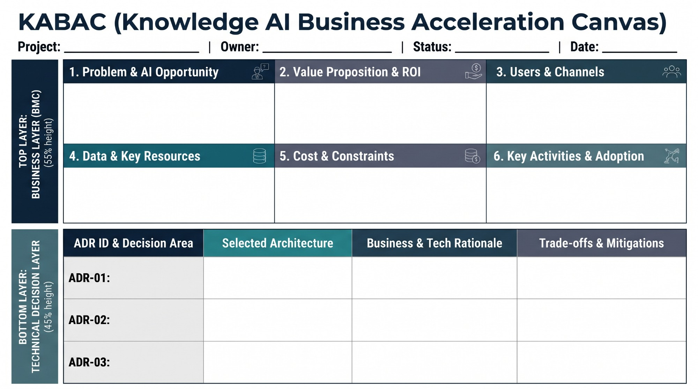

# KABAC: Knowledge AI Business Acceleration Canvas

คู่มือการใช้งานและพิมพ์เขียวมาตรฐานสำหรับการออกแบบ นำเสนอ และตัดสินใจเชิงสถาปัตยกรรมโซลูชัน AI
(ฉบับ Markdown แปลงจาก [KABAC-Manual-Template.pdf](KABAC-Manual-Template.pdf) และเพิ่มส่วน Reuse & Compliance สำหรับ Hub)

## 1. KABAC คืออะไร?

**KABAC** คือเครื่องมือวางแผนและสื่อสารโครงการ AI ในหน้ากระดาษเดียว เชื่อมโยง 4 มิติสำคัญขององค์กร:

- **Knowledge (KM):** การดึงองค์ความรู้ เอกสาร และฐานข้อมูลภายในองค์กรมาจัดโครงสร้างเพื่อสร้างมูลค่า
- **AI:** การประยุกต์ใช้เทคโนโลยีปัญญาประดิษฐ์ (เช่น Generative AI, RAG, Agentic AI) ให้ตรงจุด
- **Business (BMC):** การวิเคราะห์ความคุ้มค่าทางธุรกิจ กลุ่มผู้ใช้งาน ต้นทุน และผลตอบแทน (ROI)
- **Acceleration (ADR):** การบันทึกการตัดสินใจเชิงสถาปัตยกรรมระบบ (Architecture Decision Record) เพื่อเร่งความเร็วในการส่งมอบงาน คุมความเสี่ยง และป้องกันปัญหาคอขวดทางเทคนิค

> **วัตถุประสงค์หลัก:** ปิดช่องว่างระหว่าง *ทีมธุรกิจ/ผู้บริหาร* ที่ต้องการผลลัพธ์ที่วัดผลได้ กับ *ทีมเทคนิค/นักพัฒนา* ที่ต้องออกแบบระบบให้เสถียร ปลอดภัย และคุ้มงบ โดยบังคับให้ทุกการตัดสินใจทางเทคนิคต้องมีที่มาจากโจทย์ธุรกิจเสมอ

## 2. ขั้นตอนการใช้งาน (How to Use)

1. **กรอกจาก บน ลง ล่าง (Top-Down Design):** เริ่มระดมสมองในส่วน Top Layer (Business Layer) ให้ครบทั้ง 6 ช่องก่อน
2. **แปลงโจทย์ธุรกิจเป็นการตัดสินใจทางเทคนิค (Translate to ADR):** นำข้อมูลและข้อจำกัดด้านบนลงมาเลือกโครงสร้างระบบใน Bottom Layer พร้อมระบุเหตุผลและ Trade-offs
3. **ทบทวนและอัปเดตเป็นเอกสารมีชีวิต (Living Document):** ใช้ KABAC เป็นเอกสารกลางในการประชุมอนุมัติงบ และอัปเดต Status เมื่อสถาปัตยกรรมเปลี่ยน

## 3. วิธีการเขียนรายละเอียดในแต่ละช่อง

### Header Metadata (`meta` ใน kabac.yaml)

- **Project:** ชื่อโครงการหรือระบบ AI
- **Owner:** ทีมหรือผู้รับผิดชอบหลัก / Product Owner
- **Status:** `Draft` (กำลังร่าง), `Proposed` (เสนอขออนุมัติ), `Accepted` (อนุมัติแล้ว), `Superseded` (ถูกแทนที่ด้วยเวอร์ชันใหม่)
- **Date:** วันที่จัดทำหรืออัปเดตล่าสุด

### ส่วนที่ 1: TOP LAYER — Business Layer (BMC) (`business` ใน kabac.yaml)

| # | Canvas Block | key ใน YAML | คำถามนำ | ตัวอย่าง |
|---|---|---|---|---|
| 1 | Problem & AI Opportunity | `problem_opportunity` | ปัญหาคอขวดอยู่ตรงไหน ทำไมต้องใช้ AI | พนักงานเสียเวลาค้นหาเงื่อนไขในคู่มือ PDF เฉลี่ย 15 นาที/เคส · **โอกาส:** ใช้ AI ค้นหาและสรุปคำตอบอัตโนมัติ |
| 2 | Value Proposition & ROI | `value_roi` | ผลลัพธ์เชิงปริมาณ ทั้งเวลา คุณภาพ และตัวเงิน | สรุปข้อมูลได้ใน 30 วินาที ลดภาระแอดมิน 60% · **เป้าหมาย:** คืนทุนใน 4 เดือน |
| 3 | Users & Channels | `users_channels` | ใครใช้ กี่คน ผ่านช่องทางไหน | **Users:** พนักงานขาย 5,000 คน · **Channels:** LINE OA และ Web Admin Portal |
| 4 | Data & Key Resources | `data_resources` | ข้อมูลอยู่ที่ไหน รูปแบบอะไร อัปเดตบ่อยแค่ไหน | คลังเอกสาร PDF, นโยบายบริษัท, CRM · อัปเดตทุกสัปดาห์ ต้องการความแม่นยำสูง |
| 5 | Cost & Constraints | `cost_constraints` | ค่าใช้จ่ายรายเดือน/เริ่มต้น + ข้อจำกัดกฎหมาย (PDPA, งบ, SLA) | **Cost:** API Token, Cloud Server, ค่าดูแลระบบ · **Constraints:** ห้ามข้อมูลรั่วไหลออกนอกองค์กร (PDPA) |
| 6 | Key Activities & Adoption | `activities_adoption` | งานสำคัญที่ทำให้ระบบเกิด และแผนให้คนยอมรับใช้งาน | จัดทำ Pipeline อัปเดตเอกสารอัตโนมัติ · Pilot กลุ่มย่อยและจัดเวิร์กชอป |

### ส่วนที่ 2: BOTTOM LAYER — Technical Decision Layer (ADR) (`adr` ใน kabac.yaml)

แปลงความต้องการทางธุรกิจด้านบนเป็นการตัดสินใจเชิงสถาปัตยกรรม 3–4 ข้อที่สำคัญที่สุด:

| คอลัมน์ | key ใน YAML | คำอธิบาย |
|---|---|---|
| ADR ID & Decision Area | `id`, `area`, `category` | เช่น `ADR-01: Model & Knowledge Strategy`, `ADR-02: Infrastructure & Security`, `ADR-03: Accuracy & Guardrails` |
| Selected Architecture | `selected_architecture` | เทคโนโลยีที่เลือกใช้จริง เช่น `Commercial LLM API + RAG`, `Cloud VPC + Vector DB` |
| Business & Tech Rationale | `rationale`, `links_to` | เหตุผล โดยอ้างอิงกลับไปที่ช่องใน Business Layer เสมอ |
| Trade-offs & Mitigations | `tradeoffs_mitigations` | ข้อเสียหรือความเสี่ยงของทางเลือกนั้น พร้อมมาตรการลดผลกระทบ |

`category` ต้องเป็นหนึ่งใน `model_knowledge`, `infrastructure_security`, `accuracy_guardrails`, `other`
และ **ทุก KABAC ที่ส่งเข้า Hub ต้องมี ADR หมวด `accuracy_guardrails` อย่างน้อย 1 ข้อ**

### ส่วนที่ 3: Reuse & Compliance (เพิ่มใหม่สำหรับ Hub) (`reuse` ใน kabac.yaml)

ส่วนนี้ไม่อยู่ใน Canvas กระดาษ แต่ต้องกรอกเมื่อส่งเข้า Hub เพื่อใช้จัด Tier การ Audit และแสดงบนเว็บ

| key | ค่าที่เป็นไปได้ | ใช้ทำอะไร |
|---|---|---|
| `bu`, `company` | ข้อความ | กรองตาม BU / บริษัท |
| `asset_types` | `app`, `skill`, `prompt`, `agent`, `script`, `workflow` | ประเภทของที่ให้ดาวน์โหลด |
| `data_classification` | `public`, `internal`, `confidential`, `restricted_pii` | **กำหนด Audit Tier** |
| `connects_internal_systems` | `true` / `false` | **กำหนด Audit Tier** |
| `decision_impact` | `none`, `assistive`, `financial_or_hr` | **กำหนด Audit Tier** |
| `ai_vendor_model` | รายการ | ตรวจเรื่องข้อมูลข้ามพรมแดน (PDPA) |
| `reuse_level` | `showcase_only`, `reusable`, `production_ready` | Badge บนเว็บ |
| `maintainer`, `support` | ข้อความ / `none`, `best_effort`, `supported` | ผู้ติดต่อและระดับการดูแล |
| `license` | ข้อความ (ค่าเริ่มต้น `Internal Group License`) | สิทธิ์การนำไปใช้ |
| `repo_url`, `tags` | URL / รายการ | ลิงก์และการค้นหา |

**การคำนวณ Audit Tier** (ทำอัตโนมัติใน `scripts/validate_kabac.py`):

- **T3** ถ้า `data_classification = restricted_pii` หรือ `decision_impact = financial_or_hr`
- **T2** ถ้า `data_classification = confidential` หรือ `connects_internal_systems = true`
- **T1** กรณีอื่น

## 4. กฎเหล็ก 3 ข้อในการเขียน KABAC

1. **กระชับระดับ Bullet Point:** แต่ละช่องด้านบนไม่เกิน 2–3 บรรทัด อ่านทั้งหน้าได้ภายใน 2 นาที (schema จำกัดไว้ที่ 3 ข้อต่อช่อง)
2. **ทุก ADR ต้องมีเส้นเชื่อมโยง:** ถ้า ADR ข้อไหนอธิบายไม่ได้ว่าตอบโจทย์ช่องไหนใน Business Layer แปลว่าอาจซับซ้อนเกินความจำเป็น (schema บังคับ `links_to`)
3. **ห้ามซ่อนข้อเสีย (No Hidden Risks):** ระบุ Trade-offs & Mitigations ให้ชัด เพื่อให้ผู้บริหารและทีม Security เห็นว่าประเมินความเสี่ยงรอบด้านแล้ว (schema บังคับไม่ให้ว่าง)

## 5. แบบฟอร์ม

- ฉบับ YAML สำหรับส่ง Hub: [`template/kabac.yaml`](../template/kabac.yaml)
- ตัวอย่างที่กรอกแล้ว: [`examples/policy-search-assistant/kabac.yaml`](../examples/policy-search-assistant/kabac.yaml)
- ฉบับพิมพ์ (Printable Worksheet): [KABAC-Manual-Template.pdf](KABAC-Manual-Template.pdf) หน้า 3–4
