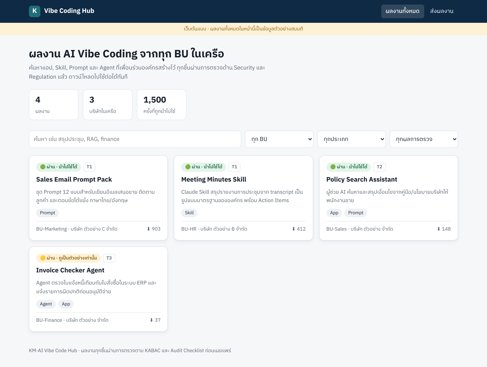

# Vibe Coding Hub (เว็บต้นแบบ)

หน้าเว็บที่คนในองค์กรเข้ามาค้นหาและดาวน์โหลดผลงาน AI Vibe Coding



ตอนนี้เป็น **ต้นแบบ** ที่ใช้ข้อมูลสมมติ 4 ผลงานจาก [`examples/`](../examples/)

## หน้าในเว็บ

| หน้า | ใช้ทำอะไร |
|---|---|
| ผลงานทั้งหมด (`#/`) | การ์ดผลงานพร้อมผลการตรวจ ค้นหา และกรองตาม BU / ประเภท / ผลการตรวจ |
| รายละเอียดผลงาน (`#/p/<slug>`) | KABAC Canvas เต็มรูปแบบ ปุ่มดาวน์โหลด ข้อมูลผู้ดูแล และผลการตรวจ |
| ส่งผลงาน (`#/submit`) | ขั้นตอนส่งผลงาน 4 ขั้น และระยะเวลาตรวจตามระดับความเสี่ยง |

## เปิดดูในเครื่อง

ดับเบิลคลิก `hub/index.html` ได้เลย หรือรันเป็นเว็บเซิร์ฟเวอร์:

```bash
python3 -m http.server -d hub 8000
```

แล้วเปิด http://localhost:8000

## ข้อมูลมาจากไหน

```
examples/*/kabac.yaml ─┐
                       ├─ scripts/build_hub_data.py ─→ hub/data/projects.js ─→ เว็บ
hub/demo-registry.yaml ┘   (ตรวจ schema + คำนวณ Tier)
```

เมื่อแก้ `kabac.yaml` หรือ registry ให้สร้างข้อมูลใหม่:

```bash
python3 scripts/build_hub_data.py
```

Tier บนเว็บคำนวณจาก `kabac.yaml` เสมอ ไม่ได้ใช้ค่าที่พิมพ์ไว้ใน registry

## ยังไม่ได้ทำ

- อ่านผลงานจริงจาก `registry/projects.yaml` และดึง `kabac.yaml` จาก repo ของแต่ละโปรเจกต์
- Login ผ่าน SSO ขององค์กร
- นับยอดดาวน์โหลดจริง และระบบให้คะแนน/คอมเมนต์
